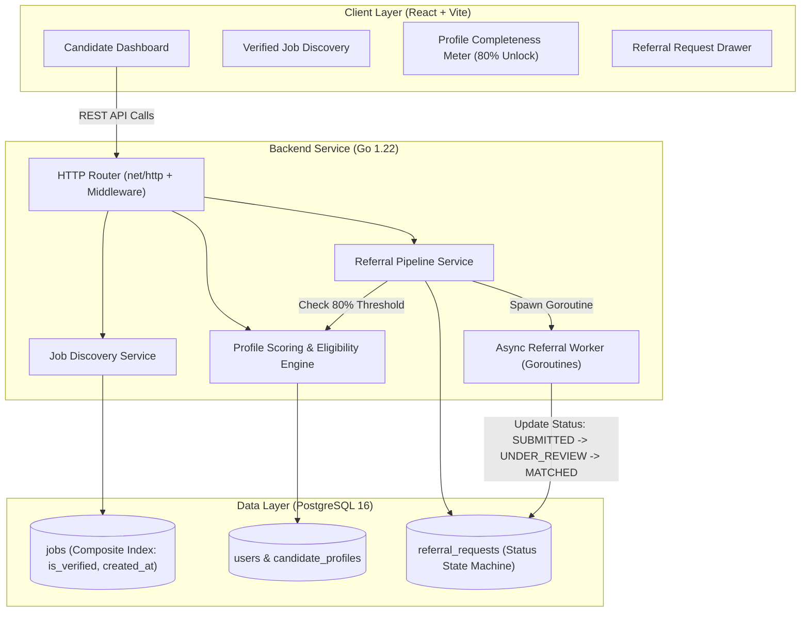

# ReferralFlow ⚡
> High-Concurrency Verified Job Discovery & Automated Referral Matching Engine

[](https://github.com/Prathmeshkate09/ReferralFlow/actions)
[](https://golang.org)
[](https://react.dev)
[](https://www.postgresql.org)
[](https://www.docker.com)

**ReferralFlow** is an end-to-end web platform designed to solve the job application "black hole". It provides job seekers with a verified directory of high-signal opportunities, an automated profile completeness qualification gate, and an asynchronous referral request pipeline that connects qualified candidates to employee referrers in under 24 hours.

Inspired by modern talent tech infrastructure (such as Presio / Auraverse), ReferralFlow is built using **Go (Golang)** for sub-millisecond API response times and asynchronous task dispatching, **PostgreSQL** with composite indexing for query performance and data integrity, and **React** for a responsive interface.

---

## 🏛️ System Architecture



---

## ✨ Core Features

### 1. High-Performance Verified Job Discovery
- **Sub-15ms Latency:** Optimized Go JSON serialization with zero external heavy frameworks.
- **Multi-tag Search & Filtering:** Dynamic query filtering across title, company, workplace mode (Remote, Hybrid, Onsite), and tech stack tags.
- **Index-Backed Queries:** Leverages PostgreSQL composite B-tree indexing on `(is_verified, created_at DESC)` to eliminate full-table sequential scans.

### 2. Profile Completeness Qualification Gate (80% Rule)
- Prevents referral spam by evaluating candidate profiles against a weighted algorithm:
  - **Verified Contact Info:** 20 points
  - **Academic Credentials:** 20 points
  - **Verified PDF Resume:** 25 points
  - **Social Presence (GitHub & LinkedIn):** 15 points
  - **Technical Skills (≥ 3 skills):** 20 points
- Candidate profile must hit **$\ge$ 80%** to unlock the 1-click referral request feature.

### 3. Concurrency-Safe Referral State Machine
- When an eligible candidate requests a referral, Go spawns an asynchronous worker using lightweight **Goroutines**.
- Seamlessly transitions request states through the referral lifecycle:
  $$\text{SUBMITTED} \longrightarrow \text{UNDER\_REVIEW} \longrightarrow \text{MATCHED\_TO\_REFERRER} \longrightarrow \text{DELIVERED}$$
- Protects database records with PostgreSQL foreign key cascades and transactional integrity.

### 4. Reactive Frontend Dashboard
- Live progress bar tracking profile completeness with real-time missing field checklists.
- 1-click referral request drawer with custom pitch notes.
- Polling-based live status tracker showing candidate referral transitions in real-time.

---

## 🛠️ Tech Stack & Decisions

| Component | Technology | Rationale |
| :--- | :--- | :--- |
| **Backend Language** | **Go (Golang 1.22)** | Native concurrency via Goroutines, compile-time type safety, ultra-low memory footprint (~15MB Docker image). |
| **Backend Architecture** | Clean Layered Architecture | Clear separation between `handler`, `service`, `repository`, and `model` layers. |
| **Database** | **PostgreSQL 16** | ACID compliance, strong relational schema with foreign key constraints, composite B-tree indexing. |
| **Frontend** | **React 18 + Vite** | Fast client-side rendering, component-driven design, and responsive styling with Tailwind CSS. |
| **Infrastructure** | **Docker & Docker Compose** | Reproducible multi-container orchestration across database, backend, and frontend. |
| **Continuous Integration** | **GitHub Actions** | Automated Go unit testing (`go test -v ./...`) and frontend build verification. |

---

## 🚀 Getting Started

### Prerequisites
- [Docker & Docker Compose](https://www.docker.com/) installed, OR
- [Go 1.22+](https://golang.org) & [Node.js 20+](https://nodejs.org)

### Option 1: Run with Docker Compose (Recommended)

```bash
# Clone the repository
git clone https://github.com/Prathmeshkate09/ReferralFlow.git
cd ReferralFlow

# Spin up Postgres, Go Backend, and React Frontend
docker-compose up --build
```
- Frontend UI: `http://localhost:3000`
- Backend API: `http://localhost:8080`
- PostgreSQL: `localhost:5432`

---

### Option 2: Run Locally (Standalone)

#### 1. Start the Go Backend
```bash
cd backend
go run cmd/server/main.go
```
The backend initializes with in-memory fallback seed data and starts listening on `:8080`.

#### 2. Start the React Frontend
```bash
cd ../frontend
npm install
npm run dev
```
Open `http://localhost:3000` in your browser.

---

## 🧪 Running Automated Tests

```bash
cd backend
go test -v ./...
```

Sample test output:
```text
=== RUN   TestEvaluateProfile_FullProfile
--- PASS: TestEvaluateProfile_FullProfile (0.00s)
=== RUN   TestEvaluateProfile_UnderThreshold
--- PASS: TestEvaluateProfile_UnderThreshold (0.00s)
PASS
ok      github.com/Prathmeshkate09/ReferralFlow/backend/internal/service    0.012s
```

---

## 📡 API Specification

| Method | Endpoint | Description |
| :--- | :--- | :--- |
| `GET` | `/api/health` | Health check and system uptime status. |
| `GET` | `/api/jobs?q={query}&workplace={mode}` | Search and filter verified job listings. |
| `GET` | `/api/profile` | Retrieve active candidate profile and completeness evaluation score. |
| `GET` | `/api/referrals` | List all active referral requests with real-time status. |
| `POST` | `/api/referrals` | Submit a referral request (enforces 80% completeness gate). |

---

## 👤 Author

**Prathmesh Kate**  
- Email: [kateprathamesh968@gmail.com](mailto:kateprathamesh968@gmail.com)  
- LinkedIn: [linkedin.com/in/prathamesh-kate-022799257](https://www.linkedin.com/in/prathamesh-kate-022799257/)  
- GitHub: [github.com/Prathmeshkate09](https://github.com/Prathmeshkate09)  

---

## 📄 License
This project is licensed under the MIT License - see the [LICENSE](LICENSE) file for details.
